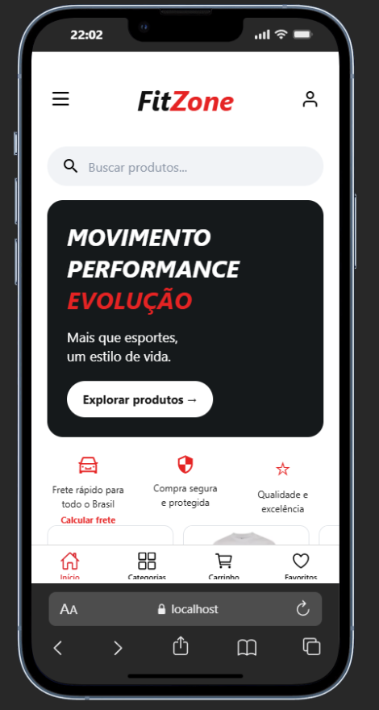

# FitZone

Aplicativo de compras e vendas de artigos esportivos: acessível, intuitivo e com muita variedade de produtos.

<p align="center">
  
</p>

<p align="center">
  <a href="docs/Telas.pdf">Ver todas as telas do app (PDF)</a>
</p>

## Sobre o projeto

O FitZone foi pensado para quem gosta de esporte e quer encontrar tudo em um só lugar. O cliente navega pelas categorias, busca produtos, monta o carrinho e calcula o frete. A equipe da loja gerencia tudo por um painel administrativo.

Projeto acadêmico desenvolvido na UNISUAM, no curso de Análise e Desenvolvimento de Sistemas, em 2026.

## Funcionalidades

**Para o cliente**
- Cadastro, login e perfil
- Busca de produtos e navegação por categorias
- Carrinho de compras com calculadora
- Cálculo de frete por meio de uma API de frete

**Painel administrativo**
- Gerenciamento de produtos
- Gerenciamento de categorias
- Acompanhamento de pedidos
- Cadastro de funcionários

## Tecnologias

- [TypeScript](https://www.typescriptlang.org/)
- [React Native](https://reactnative.dev/) com [Expo](https://expo.dev/) e Expo Router
- [Supabase](https://supabase.com/) (banco de dados)

## Como rodar o projeto

**Pré-requisitos:** [Node.js](https://nodejs.org/) instalado e um projeto no Supabase.

1. Clone o repositório:
   ```bash
   git clone https://github.com/larissadefarias/FitZone-App.git
   cd FitZone-App
   ```

2. Instale as dependências:
   ```bash
   npm install
   ```

3. A conexão com o banco fica em `src/services/supabase.ts`. Para usar o seu próprio projeto no Supabase, troque a URL e a chave pública (publishable) nesse arquivo pelas do seu projeto.

4. Inicie o app:
   ```bash
   npx expo start
   ```

No terminal, você pode abrir o app no Android, no iOS (simulador), no navegador ou no aplicativo Expo Go.

## Minha contribuição

Neste projeto, fui responsável por:
- as telas do painel administrativo (produtos, categorias, pedidos e funcionários)
- as telas do cliente: produtos, detalhes do produto e categorias
- a integração com a API de frete
- o banco de dados

## Autora

**Larissa de Farias Santos**
Estudante de Análise e Desenvolvimento de Sistemas, UNISUAM
[GitHub](https://github.com/larissadefarias)

## Licença

Veja o arquivo [LICENSE](LICENSE).
